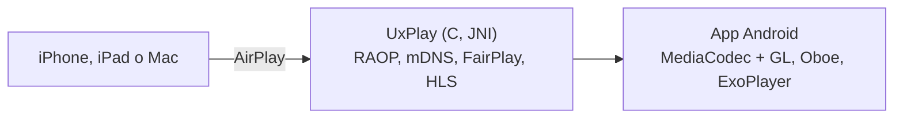

# VireoAirTV

Receptor AirPlay para Android TV. Recibe desde el iPhone, el iPad o el Mac la duplicación de pantalla, vídeo AirPlay y música, y lo muestra en la tele sin estorbar: la app solo aparece cuando hay imagen y, al terminar, devuelve la tele a la app en la que estabas.

Proyecto de [ReinierTutoriales](https://github.com/ReinierTutoriales), derivado de [jqssun/android-airplay-server](https://github.com/jqssun/android-airplay-server) y construido sobre [UxPlay](https://github.com/FDH2/UxPlay). Licencia GPL-3.0.

## Qué hace

- **Duplicación de pantalla** con decodificación por hardware H.264 y H.265 en modo de baja latencia. La tele escala la imagen una sola vez a su resolución nativa y se ajusta a la frecuencia del stream. Al girar el iPhone, la imagen cambia de formato con un fundido corto.
- **Vídeo AirPlay** (YouTube y otras apps sin DRM): la tele reproduce el vídeo por su cuenta con ExoPlayer, empezando en alta calidad. El mando controla reproducir, pausar y avanzar o retroceder.
- **Música** en ALAC (sin pérdida) o AAC, con título, artista y portada. Suena en segundo plano; los botones de reproducción del mando controlan la app del iPhone mediante DACP.
- **Mando durante la duplicación:** el botón central y las teclas de reproducción, siguiente y anterior van a la app que suena en el iPhone.
- **Comportamiento tipo Apple TV:** la app pasa al frente con la imagen y vuelve sola a la app anterior al terminar. Atrás hace lo mismo. Las pantallas de la app solo aparecen al abrirla desde el lanzador.
- Imagen en ventana pequeña, PIN de emparejamiento opcional y pantalla secundaria por cable USB para Mac y iPad.

No reproduce contenido con DRM de Apple (app Apple TV, Netflix y similares). Esas apps bloquean AirPlay hacia receptores sin certificar o envían la imagen en negro. El iPhone y la tele tienen que estar en la misma red.

## Instalación

Se instala una sola vez desde un ordenador conectado a la misma red que la tele, con ADB, la herramienta oficial de Google para Android. Al terminar, la app arranca sola al encender la tele y pasa al frente cuando proyectas.

Necesitas:

- Tele o reproductor con Android TV o Google TV (Android 7.0 o superior).
- Ordenador con Windows, macOS o Linux.
- [Android SDK Platform-Tools](https://developer.android.com/tools/releases/platform-tools), que incluye `adb` ([documentación de ADB](https://developer.android.com/tools/adb)).

### 1. Instala ADB

Con el gestor de paquetes de tu sistema:

```powershell
winget install --id Google.PlatformTools -e
```

```bash
brew install --cask android-platform-tools
```

```bash
sudo apt install adb
```

Son para Windows, macOS y Debian/Ubuntu, en ese orden. En Fedora usa `sudo dnf install android-tools` y en Arch `sudo pacman -S android-tools`.

También puedes descargar el ZIP oficial de Google, descomprimirlo y añadir la carpeta `platform-tools` al PATH: [Windows](https://dl.google.com/android/repository/platform-tools-latest-windows.zip), [macOS](https://dl.google.com/android/repository/platform-tools-latest-darwin.zip), [Linux](https://dl.google.com/android/repository/platform-tools-latest-linux.zip).

Abre una terminal nueva y comprueba que responde:

```bash
adb version
```

### 2. Activa la depuración en la tele

1. **Ajustes > Sistema > Información** (en algunas teles, **Preferencias del dispositivo > Información**): pulsa 7 veces **Compilación del SO de Android TV**.
2. Vuelve atrás, entra en **Opciones para desarrolladores** y activa **Depuración USB**. Si tu tele tiene **Depuración inalámbrica**, actívala también.
3. Apunta la IP de la tele en **Ajustes > Red e Internet**, dentro de tu red.

Solo con **Depuración inalámbrica**: entra en ella, elige **Vincular dispositivo con un código** y vincula el ordenador con la IP y el puerto que muestra esa pantalla. Después usa el puerto de la pantalla principal de Depuración inalámbrica en el paso 3.

```bash
adb pair 192.168.1.50:37001
```

### 3. Instala VireoAirTV

Cambia la IP de la primera línea por la de tu tele, copia el bloque entero y pégalo en la terminal. Descarga la última versión y el script, y lo ejecuta.

macOS o Linux:

```bash
TV=192.168.1.50:5555
curl -fLO https://github.com/ReinierTutoriales/VireoAirTV/releases/latest/download/app-release.apk
curl -fLO https://raw.githubusercontent.com/ReinierTutoriales/VireoAirTV/main/scripts/provision.sh
bash provision.sh $TV app-release.apk
```

Windows (PowerShell):

```powershell
$TV = "192.168.1.50:5555"
curl.exe -fLO https://github.com/ReinierTutoriales/VireoAirTV/releases/latest/download/app-release.apk
curl.exe -fLO https://raw.githubusercontent.com/ReinierTutoriales/VireoAirTV/main/scripts/provision.ps1
powershell -ExecutionPolicy Bypass -File .\provision.ps1 -Target $TV -ApkPath app-release.apk
```

Si la tele pregunta **¿Permitir depuración?**, marca **Permitir siempre** y acepta; el script espera. Termina con `Provisioning completed` y la tele vuelve a su pantalla de inicio.

El script instala la app, concede sus permisos sin diálogos, la excluye del ahorro de energía, activa el arranque al encender y el audio ALAC, y comprueba cada paso. Si algo falla, se detiene y dice qué.

### 4. Proyecta

En el iPhone: **Centro de control > Duplicar pantalla >** VireoAirTV. Para música o vídeo, usa el icono de AirPlay dentro de la app.

Después puedes desactivar la depuración en la tele; la app y sus ajustes se mantienen.

## Mantenimiento

Para actualizar, repite el paso 3: descarga la última versión y conserva los ajustes.

Para cambiar el nombre que ve el iPhone, usa el bloque del paso 3 con el nombre al final:

```bash
TV=192.168.1.50:5555
curl -fLO https://github.com/ReinierTutoriales/VireoAirTV/releases/latest/download/app-release.apk
curl -fLO https://raw.githubusercontent.com/ReinierTutoriales/VireoAirTV/main/scripts/provision.sh
bash provision.sh $TV app-release.apk "Salón"
```

```powershell
$TV = "192.168.1.50:5555"
curl.exe -fLO https://github.com/ReinierTutoriales/VireoAirTV/releases/latest/download/app-release.apk
curl.exe -fLO https://raw.githubusercontent.com/ReinierTutoriales/VireoAirTV/main/scripts/provision.ps1
powershell -ExecutionPolicy Bypass -File .\provision.ps1 -Target $TV -ApkPath app-release.apk -ServerName "Salón"
```

Para desinstalar (con la depuración activa, cambiando la IP):

```bash
adb connect 192.168.1.50:5555
adb uninstall com.reiniertutoriales.vireoairtv
```

### Sin ordenador

Instala `app-release.apk` con una app como Downloader. Todo funciona igual salvo una cosa: si tu tele no ofrece **Mostrar sobre otras apps** en **Ajustes > Apps > Acceso especial de apps**, la app no puede pasar al frente sola y te avisa con una notificación.

### Problemas frecuentes

- **El script dice que no encuentra `adb`:** abre una terminal nueva después de instalarlo.
- **`Cannot reach`:** revisa la IP y el puerto. Con Depuración inalámbrica el puerto cambia cada vez que se activa.
- **El iPhone no ve la tele:** tienen que estar en la misma red (no en la de invitados) y el router no debe aislar los dispositivos.
- **La app no pasa al frente al proyectar:** repite el paso 3.

## Ajustes por ADB

Cualquier ajuste se cambia desde `adb shell`. El receptor de ajustes exige `android.permission.DUMP`, así que otras apps instaladas no pueden usarlo.

```bash
am broadcast -n com.reiniertutoriales.vireoairtv/io.github.jqssun.airplay.SettingsReceiver \
  -a io.github.jqssun.airplay.SET_SETTING --es key server_name --es value "Salón"

am broadcast -n com.reiniertutoriales.vireoairtv/io.github.jqssun.airplay.SettingsReceiver \
  -a io.github.jqssun.airplay.LIST_SETTINGS
```

`LIST_SETTINGS` devuelve todos los ajustes con su valor actual en JSON.

## Compilar

```bash
git clone --recursive https://github.com/ReinierTutoriales/VireoAirTV
cd VireoAirTV
./gradlew assembleDebug testDebugUnitTest lintDebug   # -PabiFilter=arm64-v8a para una sola arquitectura
./gradlew assembleSanitize                            # HWASan + UBSan, arm64
./scripts/native-regress.sh                           # pruebas nativas de seguridad (tras compilar)
```

Necesita JDK 25, el NDK 30 y CMake 4.1.2. La CI compila, prueba y pasa lint en cada PR y en cada cambio en `main`. Las versiones firmadas se publican desde [`apk.yml`](.github/workflows/apk.yml).

## Cómo está hecho



- `app/src/main/cpp/`: puente JNI y código nativo. UxPlay, libplist, OpenSSL 4.1 y FFmpeg 9 (solo los decodificadores ALAC y AAC) son submódulos.
- `app/src/main/cpp/patches/`: los cambios sobre UxPlay y libplist van como parches numerados que Gradle aplica antes de compilar. Incluyen correcciones portadas de UxPlay y de sus PR abiertos, y defensas propias frente a mensajes abusivos en la red.
- `app/src/main/kotlin/`: app en Kotlin con Jetpack Compose, Hilt y Media3.

Documentación del proyecto:

- [Arquitectura](docs/ARQUITECTURA.md)
- [Estado verificado y pendientes](docs/AUDITORIA.md)
- [Auditoría de UxPlay y de las correcciones portadas](docs/AUDITORIA-REFERENCIAS.md)
- [Sincronización con upstream](docs/UPSTREAM.md)

## Créditos y licencia

- [jqssun/android-airplay-server](https://github.com/jqssun/android-airplay-server), base de este proyecto (GPL-3.0).
- [UxPlay](https://github.com/FDH2/UxPlay), servidor AirPlay/RAOP.
- [libplist](https://github.com/libimobiledevice/libplist), [OpenSSL](https://www.openssl.org) y [FFmpeg](https://ffmpeg.org), cada uno con su licencia dentro de su submódulo.
- [Next Player](https://github.com/anilbeesetti/nextplayer), por el reproductor de vídeo (crédito heredado de jqssun).

VireoAirTV se distribuye bajo GPL-3.0; consulta [LICENSE](LICENSE) y [NOTICE.md](NOTICE.md).

No está afiliado a Apple Inc. AirPlay es una marca de Apple Inc.
