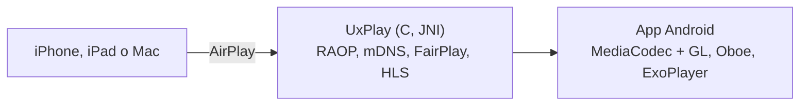

# VireoAirTV

Receptor AirPlay para Android TV. Recibe desde el iPhone, el iPad o el Mac la duplicación de pantalla, vídeo AirPlay y música, y lo muestra en la tele sin estorbar: la app solo aparece cuando hay imagen y, al terminar, devuelve la tele a la app en la que estabas.

Proyecto de [ReinierTutoriales](https://github.com/ReinierTutoriales), derivado de [jqssun/android-airplay-server](https://github.com/jqssun/android-airplay-server) y construido sobre [UxPlay](https://github.com/FDH2/UxPlay). Licencia GPL-3.0.

## Qué hace

- **Duplicación de pantalla** con decodificación por hardware H.264 y H.265 en modo de baja latencia. La tele escala la imagen una sola vez a su resolución nativa y se ajusta a la frecuencia del stream. Al girar el iPhone, la imagen cambia de formato con un fundido corto.
- **Vídeo AirPlay** (YouTube y otras apps sin DRM): la tele reproduce el vídeo por su cuenta con ExoPlayer, empezando en alta calidad. El mando controla reproducir, pausar y avanzar o retroceder.
- **Música** en ALAC (sin pérdida) o AAC, con título, artista y portada. Suena en segundo plano; los botones de reproducción del mando controlan la app del iPhone mediante DACP.
- **Mando durante la duplicación:** el botón central y las teclas de reproducción, siguiente y anterior van a la app que suena en el iPhone.
- **Comportamiento tipo Apple TV:** la app pasa al frente con la imagen y vuelve sola a la app anterior al terminar. Atrás hace lo mismo. Las pantallas de la app solo aparecen al abrirla desde el lanzador.
- Imagen en ventana pequeña, PIN de emparejamiento opcional y pantalla secundaria por cable USB para Mac y iPad.

No reproduce contenido con DRM de Apple (app Apple TV, Netflix y similares). Esas apps bloquean AirPlay hacia receptores sin certificar o envían la imagen en negro. El iPhone y la tele tienen que estar en la misma red.

Requisitos: Android 7.0 o superior. Pensada para Android TV y Google TV con mando.

## Instalación

Descarga `app-release.apk` de la [última versión](https://github.com/ReinierTutoriales/VireoAirTV/releases/latest) e instálala. El identificador es `com.reiniertutoriales.vireoairtv`.

Para que la app pueda pasar al frente sola necesita el permiso de superposición ("Mostrar sobre otras apps"), que muchos televisores no ofrecen en sus ajustes. El script de aprovisionamiento lo deja todo listo por ADB: instala la APK, concede los permisos sin diálogos, excluye la app del ahorro de energía, activa el arranque al encender y ALAC, y devuelve la tele a la pantalla de inicio.

```bash
./scripts/provision.sh 192.168.1.50:5555 app-release.apk "Salón"
```

```powershell
.\scripts\provision.ps1 -Target 192.168.1.50:5555 -ApkPath app-release.apk -ServerName "Salón"
```

Los tres argumentos son opcionales: sin APK solo aplica permisos y ajustes, y sin nombre conserva el actual.

## Ajustes por ADB

Cualquier ajuste se cambia desde `adb shell`. El receptor de ajustes exige `android.permission.DUMP`, así que otras apps instaladas no pueden usarlo.

```bash
am broadcast -n com.reiniertutoriales.vireoairtv/io.github.jqssun.airplay.SettingsReceiver \
  -a io.github.jqssun.airplay.SET_SETTING --es key server_name --es value "Salón"

am broadcast -n com.reiniertutoriales.vireoairtv/io.github.jqssun.airplay.SettingsReceiver \
  -a io.github.jqssun.airplay.LIST_SETTINGS
```

`LIST_SETTINGS` devuelve todos los ajustes con su valor actual en JSON.

## Compilar

```bash
git clone --recursive https://github.com/ReinierTutoriales/VireoAirTV
cd VireoAirTV
./gradlew assembleDebug testDebugUnitTest lintDebug   # -PabiFilter=arm64-v8a para una sola arquitectura
./gradlew assembleSanitize                            # HWASan + UBSan, arm64
./scripts/native-regress.sh                           # pruebas nativas de seguridad (tras compilar)
```

Necesita JDK 25, el NDK 30 y CMake 4.1.2. La CI compila, prueba y pasa lint en cada PR y en cada cambio en `main`. Las versiones firmadas se publican desde [`apk.yml`](.github/workflows/apk.yml).

## Cómo está hecho



- `app/src/main/cpp/`: puente JNI y código nativo. UxPlay, libplist, OpenSSL 4.1 y FFmpeg 9 (solo los decodificadores ALAC y AAC) son submódulos.
- `app/src/main/cpp/patches/`: los cambios sobre UxPlay y libplist van como parches numerados que Gradle aplica antes de compilar. Incluyen correcciones portadas de UxPlay y de sus PR abiertos, y defensas propias frente a mensajes abusivos en la red.
- `app/src/main/kotlin/`: app en Kotlin con Jetpack Compose, Hilt y Media3.

Documentación del proyecto:

- [Arquitectura](docs/ARQUITECTURA.md)
- [Estado verificado y pendientes](docs/AUDITORIA.md)
- [Auditoría de UxPlay y de las correcciones portadas](docs/AUDITORIA-REFERENCIAS.md)
- [Sincronización con upstream](docs/UPSTREAM.md)

## Créditos y licencia

- [jqssun/android-airplay-server](https://github.com/jqssun/android-airplay-server), base de este proyecto (GPL-3.0).
- [UxPlay](https://github.com/FDH2/UxPlay), servidor AirPlay/RAOP.
- [libplist](https://github.com/libimobiledevice/libplist), [OpenSSL](https://www.openssl.org) y [FFmpeg](https://ffmpeg.org), cada uno con su licencia dentro de su submódulo.
- [Next Player](https://github.com/anilbeesetti/nextplayer), por el reproductor de vídeo (crédito heredado de jqssun).

VireoAirTV se distribuye bajo GPL-3.0; consulta [LICENSE](LICENSE) y [NOTICE.md](NOTICE.md).

No está afiliado a Apple Inc. AirPlay es una marca de Apple Inc.
