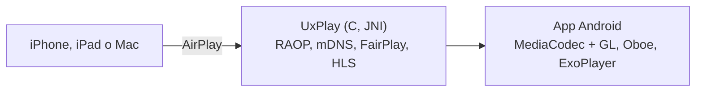

# VireoAirTV

Receptor AirPlay para Android TV. Recibe desde el iPhone, el iPad o el Mac la duplicación de pantalla, vídeo AirPlay y música, y lo muestra en la tele sin estorbar: la app solo aparece cuando hay imagen y, al terminar, devuelve la tele a la app en la que estabas.

Proyecto de [ReinierTutoriales](https://github.com/ReinierTutoriales), derivado de [jqssun/android-airplay-server](https://github.com/jqssun/android-airplay-server) y construido sobre [UxPlay](https://github.com/FDH2/UxPlay). Licencia GPL-3.0.

## Qué hace

- **Duplicación de pantalla** con decodificación por hardware H.264 y H.265 en modo de baja latencia. La tele escala la imagen una sola vez a su resolución nativa y se ajusta a la frecuencia del stream. Al girar el iPhone, la imagen cambia de formato con un fundido corto.
- **Vídeo AirPlay** (YouTube y otras apps sin DRM): la tele reproduce el vídeo por su cuenta con ExoPlayer, empezando en alta calidad. El mando controla reproducir, pausar y avanzar o retroceder.
- **Música** en ALAC (sin pérdida) o AAC, con título, artista y portada. Suena en segundo plano; los botones de reproducción del mando controlan la app del iPhone mediante DACP.
- **Mando durante la duplicación:** el botón central y las teclas de reproducción, siguiente y anterior van a la app que suena en el iPhone.
- **Comportamiento tipo Apple TV:** la app pasa al frente con la imagen y vuelve sola a la app anterior al terminar. Atrás hace lo mismo. Las pantallas de la app solo aparecen al abrirla desde el lanzador.
- Imagen en ventana pequeña, PIN de emparejamiento opcional y pantalla secundaria por cable USB para Mac y iPad.

No reproduce contenido con DRM de Apple (app Apple TV, Netflix y similares). Esas apps bloquean AirPlay hacia receptores sin certificar o envían la imagen en negro. El iPhone y la tele tienen que estar en la misma red.

## Instalación

La forma recomendada usa un ordenador con ADB y el script de aprovisionamiento. Así la app queda con todos los permisos, arranca sola al encender la tele y puede pasar al frente cuando proyectas. Solo hay que hacerlo una vez.

### Qué necesitas

- Una tele o reproductor con Android TV o Google TV, Android 7.0 o superior.
- Un ordenador con Windows, macOS o Linux en la misma red que la tele.
- El iPhone, iPad o Mac conectado también a esa red.

### 1. Instala ADB en el ordenador

| Sistema | Comando |
|---|---|
| Windows | `winget install --id Google.PlatformTools -e` y cierra y vuelve a abrir la terminal |
| macOS | `brew install --cask android-platform-tools` |
| Debian, Ubuntu | `sudo apt install adb` |
| Fedora | `sudo dnf install android-tools` |
| Arch | `sudo pacman -S android-tools` |

Comprueba que funciona con `adb version`. También puedes descargar las [Platform-Tools oficiales](https://developer.android.com/tools/releases/platform-tools) y descomprimirlas.

### 2. Activa la depuración en la tele

1. Ve a **Ajustes > Sistema > Información** y pulsa 7 veces seguidas sobre **Compilación del SO de Android TV** hasta que aparezca el aviso de que ya eres desarrollador. En algunos modelos está en **Preferencias del dispositivo > Información**.
2. Vuelve atrás y entra en **Opciones para desarrolladores**.
3. Activa **Depuración inalámbrica** si aparece (Android TV 13 o superior). Si no, activa **Depuración USB** y, si existe, **Depuración por red**.
4. Anota la IP de la tele. Aparece en la pantalla de Depuración inalámbrica o en **Ajustes > Red e Internet**, dentro de la red a la que está conectada.

### 3. Conecta el ordenador con la tele

**Con Depuración inalámbrica.** En la tele, dentro de Depuración inalámbrica, elige **Vincular dispositivo con un código**. Muestra una IP con un puerto de vinculación y un código de 6 cifras. En el ordenador:

```bash
adb pair 192.168.1.50:37001        # IP y puerto de vinculación; pide el código
adb connect 192.168.1.50:41235     # IP y puerto de conexión de la pantalla principal de Depuración inalámbrica
```

Los dos puertos son distintos y cambian cada vez que se activa la depuración: usa los que muestre tu tele.

**Con Depuración USB o por red.**

```bash
adb connect 192.168.1.50:5555
```

En la tele aparece **¿Permitir depuración?**. Marca **Permitir siempre desde este ordenador** y acepta.

Comprueba la conexión con `adb devices`. La tele debe aparecer como `device`; si aparece `unauthorized`, acepta el aviso en la tele.

### 4. Descarga la APK y el script

En macOS o Linux:

```bash
curl -LO https://github.com/ReinierTutoriales/VireoAirTV/releases/latest/download/app-release.apk
curl -LO https://raw.githubusercontent.com/ReinierTutoriales/VireoAirTV/main/scripts/provision.sh
```

En Windows (PowerShell):

```powershell
Invoke-WebRequest https://github.com/ReinierTutoriales/VireoAirTV/releases/latest/download/app-release.apk -OutFile app-release.apk
Invoke-WebRequest https://raw.githubusercontent.com/ReinierTutoriales/VireoAirTV/main/scripts/provision.ps1 -OutFile provision.ps1
```

### 5. Instala y aprovisiona

Usa la IP y el puerto con los que conectaste en el paso 3. El último argumento es el nombre que verá el iPhone; es opcional.

```bash
bash provision.sh 192.168.1.50:5555 app-release.apk "Salón"
```

```powershell
powershell -ExecutionPolicy Bypass -File .\provision.ps1 -Target 192.168.1.50:5555 -ApkPath app-release.apk -ServerName "Salón"
```

El script:

- instala la APK y concede los permisos de notificaciones y de red local, sin diálogos en la tele;
- concede el permiso de superposición para que la app pueda pasar al frente;
- excluye la app del ahorro de energía para que no se duerma esperando al iPhone;
- activa el arranque al encender, la ejecución en segundo plano, la apertura al recibir imagen y el audio ALAC;
- deja la tele en su pantalla de inicio.

Si algún paso falla, el script se detiene y muestra el error. Si un permiso no se puede conceder, avisa y sigue.

### 6. Pruébalo

En el iPhone abre el **Centro de control**, pulsa **Duplicar pantalla** y elige el nombre de la tele. La tele mostrará la pantalla del iPhone y volverá sola a donde estabas al dejar de proyectar. Para música o vídeo, usa el icono de AirPlay dentro de la app.

Cuando todo funcione puedes desactivar la depuración en la tele: los permisos y ajustes se mantienen.

### Actualizar

Descarga la nueva APK y repite el paso 5 con el mismo comando. Se conservan los ajustes.

### Sin ordenador

Puedes instalar `app-release.apk` con una app como Downloader o enviándola a la tele, después de permitir instalar apps de origen desconocido. El receptor funciona igual, pero la app no podrá pasar al frente sola si tu tele no ofrece el permiso **Mostrar sobre otras apps** en **Ajustes > Apps > Acceso especial de apps**. En ese caso aparece una notificación para abrirla.

### Si algo falla

| Síntoma | Solución |
|---|---|
| El iPhone no ve la tele | Comprueba que están en la misma red (no en la de invitados) y que el router no aísla los dispositivos ni bloquea multicast. Abre la app una vez para confirmar que el receptor está activo. |
| `adb connect` no responde | Revisa la IP y el puerto en la pantalla de depuración de la tele; con Depuración inalámbrica, vuelve a vincular con `adb pair`. |
| `adb devices` muestra `unauthorized` | Acepta el aviso de depuración en la tele. |
| La app no pasa al frente al proyectar | Vuelve a ejecutar el script: concede el permiso de superposición. |
| PowerShell no deja ejecutar el script | Ejecútalo con `powershell -ExecutionPolicy Bypass -File .\provision.ps1 ...` como en el paso 5. |

## Ajustes por ADB

Cualquier ajuste se cambia desde `adb shell`. El receptor de ajustes exige `android.permission.DUMP`, así que otras apps instaladas no pueden usarlo.

```bash
am broadcast -n com.reiniertutoriales.vireoairtv/io.github.jqssun.airplay.SettingsReceiver \
  -a io.github.jqssun.airplay.SET_SETTING --es key server_name --es value "Salón"

am broadcast -n com.reiniertutoriales.vireoairtv/io.github.jqssun.airplay.SettingsReceiver \
  -a io.github.jqssun.airplay.LIST_SETTINGS
```

`LIST_SETTINGS` devuelve todos los ajustes con su valor actual en JSON.

## Compilar

```bash
git clone --recursive https://github.com/ReinierTutoriales/VireoAirTV
cd VireoAirTV
./gradlew assembleDebug testDebugUnitTest lintDebug   # -PabiFilter=arm64-v8a para una sola arquitectura
./gradlew assembleSanitize                            # HWASan + UBSan, arm64
./scripts/native-regress.sh                           # pruebas nativas de seguridad (tras compilar)
```

Necesita JDK 25, el NDK 30 y CMake 4.1.2. La CI compila, prueba y pasa lint en cada PR y en cada cambio en `main`. Las versiones firmadas se publican desde [`apk.yml`](.github/workflows/apk.yml).

## Cómo está hecho



- `app/src/main/cpp/`: puente JNI y código nativo. UxPlay, libplist, OpenSSL 4.1 y FFmpeg 9 (solo los decodificadores ALAC y AAC) son submódulos.
- `app/src/main/cpp/patches/`: los cambios sobre UxPlay y libplist van como parches numerados que Gradle aplica antes de compilar. Incluyen correcciones portadas de UxPlay y de sus PR abiertos, y defensas propias frente a mensajes abusivos en la red.
- `app/src/main/kotlin/`: app en Kotlin con Jetpack Compose, Hilt y Media3.

Documentación del proyecto:

- [Arquitectura](docs/ARQUITECTURA.md)
- [Estado verificado y pendientes](docs/AUDITORIA.md)
- [Auditoría de UxPlay y de las correcciones portadas](docs/AUDITORIA-REFERENCIAS.md)
- [Sincronización con upstream](docs/UPSTREAM.md)

## Créditos y licencia

- [jqssun/android-airplay-server](https://github.com/jqssun/android-airplay-server), base de este proyecto (GPL-3.0).
- [UxPlay](https://github.com/FDH2/UxPlay), servidor AirPlay/RAOP.
- [libplist](https://github.com/libimobiledevice/libplist), [OpenSSL](https://www.openssl.org) y [FFmpeg](https://ffmpeg.org), cada uno con su licencia dentro de su submódulo.
- [Next Player](https://github.com/anilbeesetti/nextplayer), por el reproductor de vídeo (crédito heredado de jqssun).

VireoAirTV se distribuye bajo GPL-3.0; consulta [LICENSE](LICENSE) y [NOTICE.md](NOTICE.md).

No está afiliado a Apple Inc. AirPlay es una marca de Apple Inc.
